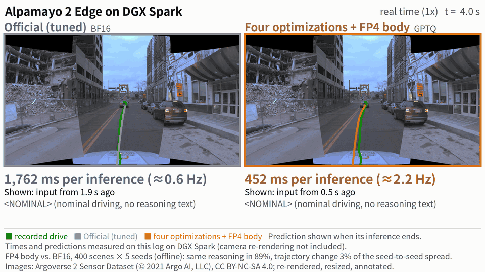

# Running Alpamayo 2 Edge on Argoverse 2 at 1 Hz on a single DGX Spark (GB10)

> **New (2026-11-22): FP4 decode kernel and TensorRT Edge-LLM.** With a custom FP4 decode kernel (4-bit body calibrated
> with GPTQ on 48 AV2 logs, output layer in BF16), one inference takes **0.64 s instead of 1.9 s** with the official
> acceleration (tuned), **3.0× faster** (the FP8 body below: 2.8×). TensorRT Edge-LLM also runs on the Spark: faster for
> the ViT and prefill, slower than the FP4 kernel for decoding; its NVFP4 W4A16 mode needs a one-line workaround for a
> TensorRT bug (NVIDIA/TensorRT#4949).
> **Article:** [`docs/article_fp4_en.md`](docs/article_fp4_en.md) (Japanese version on [Qiita](https://qiita.com/nabe2030/items/6b71bfbfd04b06599240)).
> Code and how to run: [FP4 decode kernel](#fp4-decode-kernel-second-article) and [TensorRT Edge-LLM](#tensorrt-edge-llm-second-article) below.



*The same drive and interval as the animation below, played in real time. Left: official tuned (1,858 ms per inference, median). Right: the four optimizations + FP4 body with GPTQ, BF16 output layer (612 ms). In these 11 s, 7 inferences finished on the left and 23 on the right. Times and predictions were measured on this log. Images: Argoverse 2 (© 2021 Argo AI, LLC), CC BY-NC-SA 4.0.*

The rest of this README up to "FP4 decode kernel" describes the first article (four optimizations and the FP8 body).


*One Argoverse 2 drive (log 9e9bcfb7, 4–15 s) played in real time. Left: official tuned (about 1.9 s per inference). Right: the four optimizations + FP8 body only (about 0.7 s). Each prediction appears when its inference finishes; times and predictions were measured on this log. Images: Argoverse 2 (© 2021 Argo AI, LLC), CC BY-NC-SA 4.0.*

**Article:** the write-up is [`docs/article_en.md`](docs/article_en.md). A Japanese version of the article is on [Qiita](https://qiita.com/nabe2030/items/f220eb860dda549e966d).

We ran NVIDIA's driving VLA model [Alpamayo 2 Edge](https://huggingface.co/nvidia/Alpamayo2-Edge) on camera
footage from the public [Argoverse 2 Sensor](https://www.argoverse.org/av2.html) dataset (AV2). With four inference
optimizations and a custom FP8 decode kernel, we measured whether continuous 1 Hz inference fits on one NVIDIA GB10,
and compared the outputs (trajectories and reasoning text) of FP8 against BF16. This repository holds the code and the results.

It does not contain the model weights, the upstream code or any AV2 data. Get each from its distributor.

## Contents

| Folder | Contents |
|---|---|
| `kernels/fp8_gemv/` | CUDA kernel for FP8 (E4M3) weight × BF16 vector products (`fp8_gemv.cu`), build script (`build.sh`), and a standalone benchmark on synthetic data that needs neither a dataset nor the model (`bench_fp8_gemv.py`) |
| `kernels/fp4_gemv/` | CUDA kernel for FP4 (E2M1, NVFP4-like scales) weight × BF16 vector products (`fp4_gemv.cu`), build script for sm_121a (`build.sh`), and a standalone benchmark on synthetic data (`bench_fp4_gemv.py`) |
| `accel/` | The four optimizations (`a2e_stagea.py`) and the FP8 weights for CoT decoding (`a2e_fp8.py`). Both patch the loaded model from outside; the upstream code is not edited |
| `accel/` (FP4) | FP4 weights for CoT decoding: plain rounding and loading the FP4 kernel (`a2e_fp4.py`); GPTQ and other rounding methods, calibration statistics and installation into the official acceleration (`a2e_fp4q.py`) |
| `av2_input/` | Scripts that build Alpamayo 2 Edge inputs (the same dict as the official loader) from AV2 logs: download, scene selection, re-rendering to virtual cameras, navigation text |
| `measure/` | Speed measurements (single input / continuous 10 Hz and 1 Hz / including re-rendering), BF16 vs FP8 output comparisons, the stopped-scene study, the input-layout comparison (`av2_eval.py`), summaries and plots |
| `results/` | Result tables and plots on AV2 (no AV2 images) |
| `results_av2_images/` | Figures that contain AV2 images (with attribution; CC BY-NC-SA 4.0; see `results_av2_images/LIST.md`) |
| `results/fp4/` | Result tables of the FP4 / TensorRT Edge-LLM article (no AV2 images; see `results/fp4/README.md`) |
| `tensorrt/` | Running the VLM part on TensorRT Edge-LLM: checkpoint conversion, AV2 calibration for NVFP4, engine builds, comparison with PyTorch, timing, and the `pack_qkv` workaround for W4A16 (`pack_qkv_maxcopy.patch`). `tensorrt/w4a16_bug/` holds the TensorRT-only reproducer of NVIDIA/TensorRT#4949. See `tensorrt/README.md` |
| `docs/` | The English article (`article_en.md`) and its figures. `docs/figs_av2/` holds article figures 6, 7 and 11 and the real-time demo animation shown above (they contain AV2 images; CC BY-NC-SA 4.0; source, modifications and license in `docs/figs_av2/README.md`). They are drawn by `measure/article_figs.py` |
| `docs/` (FP4) | The English version of the second article (`article_fp4_en.md`), its figures 1–9 (`figs_fp4_en/`, drawn by `figs_fp4_en/make_figs_fp4_en.py`, no AV2 images) and the FP4 demo animation (`figs_av2/demo_realtime_fp4.gif`, contains AV2 images; CC BY-NC-SA 4.0) |
| `LICENSES/` | Apache-2.0 (this code and the upstream code) and CC BY-NC-SA 4.0 (AV2) |

## The four optimizations and FP8

The numbers (#1 etc.) are our working names and match the section headings in `accel/a2e_stagea.py`. The article calls them ① to ④ (#1 = ①, #9 = ②, #2 = ③, #3 = ④).

1. **#1 Load the processor once** (`install_processor_once`): the official preprocessing calls `AutoProcessor.from_pretrained` on every call (still true on upstream main `02f55a7` as of 2026-11-20). Read it once instead. This is the same change as the upstream proposal PR #11.
2. **#9 Resize images on the GPU** (`GpuPrep`): resize, patchify and normalize the 22 images on the GPU. Resized uint8 pixels can differ from upstream by at most 1. The prompt, token ids and image grid sizes match upstream.
3. **#2 Reuse ViT results** (`VitFeatureCache`): with continuous input, a frame comes back as history at later timestamps, so reuse its earlier ViT output (keyed by camera, timestamp, grid and a pixel fingerprint).
4. **#3 Compile the ViT too** (CUDA graphs, `VisionAccel`). The official acceleration leaves the ViT eager.
- **FP8 decoding** (`a2e_fp8.py` + `kernels/fp8_gemv`): during CoT decoding (batch 1), read the weights of the language model's linear layers (the 28-layer body) as E4M3 with per-row scales. The output layer can be FP8 too (`--q all`), but that shifts the first reasoning token slightly towards "proceed", so **we recommend FP8 body only (`--q body`)**. Prefill, ViT and the trajectory expert stay in BF16.

These sit on top of the official acceleration (`alpamayo2_edge.accel`, `mode="tuned"`).

## How to run

### 1. Requirements

- Upstream code: https://github.com/NVlabs/alpamayo2-edge (we measured commit `02f55a7`) in `$A2E_ROOT/src/alpamayo2-edge`, with its `.venv` built as in the upstream README (including FlashAttention 2; on GB10 we built flash-attn 2.8.3 for sm_121).
- Model: https://huggingface.co/nvidia/Alpamayo2-Edge in `$A2E_ROOT/models/Alpamayo2-Edge` (check the terms on the model page). We measured revision `f8951d0`; main as of 2026-11-20 (`b92b6aa`) has the same weights and configs and differs only in the model card.
  Example: `hf download nvidia/Alpamayo2-Edge --local-dir $A2E_ROOT/models/Alpamayo2-Edge`
- To build the FP8 kernel: an nvcc that supports sm_121 (CUDA 12.9 or later) and ninja (e.g. `$PY -m pip install ninja`, or a ninja binary on PATH; without it the build stops with `Ninja is required to load C++ extensions`). We measured with CUDA 12.9 (matching PyTorch's cu129). The CUDA 13.0 nvcc of DGX OS 7.6.0 (`/usr/local/cuda`) also built the kernel and passed the standalone benchmark (2026-11-20).
- AV2 data: step 4 below downloads only the frames needed for each scene (about 10 MB per scene).

### 2. Environment

```bash
cp env.example.sh env.sh      # edit A2E_ROOT, A2E_WORK (and CUDA_HOME if needed)
source env.sh                 # sets PY (the upstream venv's python), PYTHONPATH, A2E_REPO, ... and cds to A2E_WORK
```

`env.sh` sets `A2E_ROOT`, `A2E_WORK`, `A2E_MODEL`, `A2E_FP8_SO` (where the kernel .so goes), `A2E_REPO` (this repository),
`PY`, `CUDA_HOME`, `PYTHONPATH` (upstream `src` plus `accel/`, `av2_input/` and `measure/` of this repository) and the compiler cache paths.

### 3. FP8 kernel (no data, no model)

```bash
PY=$PY $A2E_REPO/kernels/fp8_gemv/build.sh $(dirname $A2E_FP8_SO)    # a few minutes; stops if it already exists
$PY $A2E_REPO/kernels/fp8_gemv/bench_fp8_gemv.py $A2E_FP8_SO --out $A2E_WORK/fp8_gemv_bench.json
```

The default architectures are sm_120 / sm_121 (GB10). Change `ARCH_FLAGS` for other GPUs (FP8 conversion needs sm_89 or later).
The benchmark reports correctness (relative error against the same FP8 weights dequantized to FP32; below 0.2% is normal)
and the time of the kernel, BF16 `F.linear`, and a read-only kernel.

### 4. Inference on one AV2 scene (minimal check)

```bash
# Scene list (CSV with columns scene_id, split, log_id, t0_rel_s; t0_rel_s is seconds from the first frame of the log)
mkdir -p $A2E_WORK/data/av2 $A2E_WORK/inputs $A2E_WORK/raw/speed
printf "scene_id,split,log_id,t0_rel_s\nv_9e9bcfb7_8.5,val,9e9bcfb7-601d-3d80-bc12-ef7025174beb,8.5\n" > $A2E_WORK/scenes.csv
# Download only the needed frames from the public S3 bucket (anonymous HTTPS). The third argument is a folder of fully
# downloaded logs (an empty folder is fine)
$PY $A2E_REPO/av2_input/av2_fetch_frames.py $A2E_WORK/scenes.csv $A2E_WORK/data/av2 $A2E_WORK/data/av2/full $A2E_WORK/scenes_t0.csv 1
# Build the input (re-render to virtual cameras, navigation text from the recorded drive; layout wide_ft)
$PY $A2E_REPO/av2_input/av2_make_input.py $A2E_WORK/data/av2/val/9e9bcfb7-601d-3d80-bc12-ef7025174beb 8.5 $A2E_WORK/inputs/9e9bcfb7_8.5.pt
# Single-input timing: official tuned + the four optimizations + FP8 body only. The first run compiles for a few minutes
$PY $A2E_REPO/measure/a2e_bench2.py --model $A2E_MODEL --mode single --input pt:$A2E_WORK/inputs/9e9bcfb7_8.5.pt \
    --accel tuned --feat p,g,c,v --q body --runs 5 --label C_body_s43 --out $A2E_WORK/raw/speed/C_body_s43.jsonl
# Summary (Markdown and JSON)
$PY $A2E_REPO/measure/summarize_speed.py $A2E_WORK/raw/speed $A2E_WORK/raw/speed/summary_speed.md $A2E_WORK/raw/speed/summary_speed.json
```

`--feat` selects the optimizations (p = #1, g = #9, c = #2, v = #3) and `--q` the FP8 scope (`none` / `body` / `head` / `all`).
For the official path use `--accel tuned --feat "" --q none` (or `--accel off`).
On this scene (seed 43, 18 reasoning tokens) we measured 1927 ms for official tuned and 695 ms with the four optimizations + FP8 body only (median of 20 runs).

### 5. Full measurements

- Speed: `measure/run_speed.sh` (single / continuous), `measure/run_stream_multi.sh` (continuous over 12 logs), `measure/run_e2e.sh` (including re-rendering)
- BF16 vs FP8: `measure/run_wide.sh` (`wide_eval.py`), `measure/av2_stopgo.py` (more seeds on stopped scenes)
- Input layouts and navigation text (BF16): `measure/av2_eval.py` (its records `raw/cfg.jsonl` and `raw/samples/` are used for article figure 6)
- Article figures 6, 7 and 11: `measure/article_figs.py` (see `docs/figs_av2/README.md`)
- Real-time demo animation: `measure/demo_realtime.py` (real-time loop: each inference starts on the latest input when the previous one ends) and `measure/demo_frames.py` (frames; ffmpeg commands at the top of the script)
- Summaries: `summarize_speed.py`, `summarize_multi.py`, `summarize_wide.py`, `summarize_stopgo.py`
- `run_*.sh` read `env.sh` in this repository (set `A2E_ENV=/path/to/env.sh` to use another). Put full logs in `$A2E_WORK/data/av2/val/` (`av2_input/av2_fetch.py`).

## How the AV2 inputs are built (important assumptions)

- **Camera re-mapping**: Alpamayo 2 Edge expects NVIDIA's camera rig (120° front wide, 30° front tele, sides, rears). AV2 has seven ring cameras with other headings and fields of view. Every slot is re-rendered from the ring cameras into a 1920×1080 "virtual camera" using the calibration.
  - Front and cross (side-front): 120° equidistant (f-theta)
  - Rear: 70°
  - Tele: the central 30° of the front-center camera
  - Areas no source camera covers stay black. Filling them with gray or edge colors made no difference.
- **The navigation text is derived from the recorded drive** (the ego vehicle's actual future motion), e.g. "Turn left in 10m", "Continue straight". In a real car it comes from route planning, so this leaks part of the answer. For reference we also report runs with "Continue straight" everywhere.
- **Re-rendering time is reported separately from inference.** "Inference only" numbers exclude it; numbers including it are reported separately (`results/`).
- Timestamp jitter: AV2 frame timestamps deviate from the 50 ms grid by a few ns, so "the frame at or before the requested time" uses a 1 ms tolerance.

## Environment and versions

| | |
|---|---|
| Machine | NVIDIA DGX Spark (GB10, compute capability 12.1), DGX OS 7.6.0, driver 580.178.04 |
| PyTorch | 2.8.0+cu129 (CUDA 12.9), torchvision 0.23.0, triton 3.4.0 |
| transformers | 5.17.0 |
| flash-attn | 2.8.3 (built for sm_121) |
| alpamayo2-edge | `02f55a7` (same as main on 2026-11-20) |
| Model | nvidia/Alpamayo2-Edge revision `f8951d095de3589b3face1dec3f4394c8ecedb38` (downloaded 2026-11-18; same weights and configs as main `b92b6aa` on 2026-11-20) |
| FP8 kernel | `kernels/fp8_gemv/fp8_gemv.cu`, nvcc 12.9, `-O3 --use_fast_math`, sm_120/sm_121 |
| FP4 kernel (second article) | `kernels/fp4_gemv/fp4_gemv.cu`, nvcc 12.9, `-O3 --use_fast_math`, sm_121a |
| TensorRT side (second article) | TensorRT Edge-LLM 0.12.0, TensorRT 10.16.1.11 (pip `tensorrt-cu13`), ModelOpt 0.45.0 (with torch 2.14.0+cu130 in a separate venv) |
| Sampling | Same as the official `inference`: temperature 0.6, top_p 0.98, 10 diffusion steps, 1 sample |

## AV2 access and license

- Source: `s3://argoverse/datasets/av2/sensor/` (anonymous access; see https://argoverse.github.io/user-guide/getting_started.html )
- License: **CC BY-NC-SA 4.0** (https://creativecommons.org/licenses/by-nc-sa/4.0/ ). Terms of use: https://www.argoverse.org/about.html#terms-of-use
- Attribution used in the figures: `Images: Argoverse 2 (CC BY-NC-SA 4.0, © 2021 Argo AI, LLC)`
- Citation: Wilson et al., "Argoverse 2: Next Generation Datasets for Self-driving Perception and Forecasting", NeurIPS Datasets and Benchmarks 2021
- **Figures containing AV2 images** (`results_av2_images/` and `docs/figs_av2/`) are adaptations of AV2 images and are released under CC BY-NC-SA 4.0 (non-commercial, share-alike), separately from the code license.
- No AV2 images, raw tensors or AV2 files are included.

## License

- **Code: Apache License 2.0** (`LICENSES/Apache-2.0.txt`). Copyright (c) 2026 [nabe2030](https://github.com/nabe2030).
- Our own code files (`.py`, `.sh`, `.cu`) start with `SPDX-FileCopyrightText: Copyright (c) 2026 nabe2030` and `SPDX-License-Identifier: Apache-2.0`.
- Three files contain modified upstream code (each starts with the original copyright notice, nabe2030's copyright notice for the modifications, and a statement of the changes):
  - `accel/a2e_fp8.py`, `DecodeStepQ.forward`: follows the CoT decode step in upstream `alpamayo2_edge/accel/decode.py`; its linear layers call the FP8 kernel.
  - `accel/a2e_stagea.py`, `GpuPrep`: follows upstream `alpamayo2_edge/helper.py` `prepare_model_inputs` and moves image processing to the GPU.
  - `accel/a2e_fp4q.py`, `CalibStep.forward`: follows the CoT decode step in upstream `alpamayo2_edge/accel/decode.py` (BF16) and records the input statistics of every projection for GPTQ.
  - Upstream: NVlabs/alpamayo2-edge, Copyright (c) 2026 NVIDIA CORPORATION & AFFILIATES, Apache-2.0.
- Figures in `results_av2_images/` and `docs/figs_av2/`, including the demo animations `docs/figs_av2/demo_realtime.gif` and `docs/figs_av2/demo_realtime_fp4.gif`: CC BY-NC-SA 4.0 (above). The figures of the second article (`docs/figs_fp4_en/`) contain no AV2 images (like `docs/figs_en/`).
- `tensorrt/pack_qkv_maxcopy.patch` is a patch for NVIDIA TensorRT-Edge-LLM 0.12.0 (Apache-2.0); its context lines are from `tensorrt_edgellm/builder/ops/transformer.py` of that project (Copyright (c) 2026 NVIDIA CORPORATION & AFFILIATES, Apache-2.0). TensorRT Edge-LLM itself is not included.
- Upstream files, model weights (NVIDIA's license) and AV2 data are not included.

## Results (AV2, one NVIDIA GB10)

Tables are in `results/summary_*.md/json` and `results/compare_3configs.md`; plots in `results/fig_*.png`.

### Single input (log 9e9bcfb7, t0 = 8.5 s, seed 43, 18 tokens, median of 20 runs)

| Setup | Time |
|---|---|
| Official, no acceleration | 2524 ms |
| Official tuned | 1927 ms (847 ms without the 1081 ms preprocessing) |
| + load the processor once | 932 ms |
| + all four optimizations | 790 ms |
| + FP8 body only (recommended) | 695 ms |
| + FP8 body + output layer (reference) | 678 ms |

### Continuous (12 logs, `compare_3configs.md`)

| Setup | Inference only, 10 Hz median / max | Inference only, 1 Hz median / max | With re-rendering, 1 Hz median / max | Over 1 s | Per token |
|---|---|---|---|---|---|
| Four optimizations (BF16) | 641 / 867 ms | 757 / 977 ms | 849 / 1077 ms | 0% inference only, 1.4% with re-rendering | 15.4 ms |
| + FP8 body only (recommended) | 528 / 685 ms | 638 / 780 ms | 736 / 878 ms | 0% | 10.0 ms |
| + FP8 body + output layer (reference) | 512 / 644 ms | 620 / 752 ms | 715 / 852 ms | 0% | 9.2 ms |

- Inference only: 1428 steps at 10 Hz and 432 steps at 1 Hz per setup. With re-rendering: 432 steps at 1 Hz.
- Reasoning length that fits in 1 s (1 Hz fit): 37 tokens (BF16), 58 (FP8 body only), 63 (FP8 body + output layer). The longest reasoning over the 12 logs was 37 tokens.

- Slow steps are explained almost entirely by reasoning length (time ≈ fixed part + per-token time × tokens).
- Re-rendering used the faster renderer with pixel-identical output (`av2_render_fast.py`): about 94 ms at 1 Hz.

### BF16 vs FP8 outputs (400 scenes × 5 seeds, `summary_wide.md`)
- With the same seed, the trajectory difference is 1.8% (FP8 body only) / 2.0% (FP8 body + output layer) of the BF16 seed-to-seed spread.
- The change in error against the recorded drive is within ±0.004 m, with no trend by maneuver or city.

### Scenes where the car should stay stopped (22 scenes × 64 seeds, plus 117 scenes × 16 seeds, `summary_stopgo.md`)
- The share of trajectories that start moving (≥ 2 m in 3 s) does not change between BF16 and FP8 (−0.1 pt, 95% CI [−0.5, +0.4]).
- With the output layer in FP8, the probability that the first reasoning token is a "proceed"-type token rises (+1.45 pt over 22 scenes, same direction in all 22). FP8 on the output layer alone gives the same direction, so the output layer is the main source.
- With FP8 body only it is +0.37 pt (−0.05 pt over the 117 scenes).

## FP4 decode kernel (second article)

The second article ([`docs/article_fp4_en.md`](docs/article_fp4_en.md)) replaces the FP8 body with an FP4 body during CoT decoding.

- **Format** (close to NVIDIA's NVFP4): E2M1 weights, two per byte; one E4M3 scale per 16 elements; one FP32 scale per row
  (4.5 bits per element; the 28 body layers shrink from about 2.8 GB in BF16 to 795 MB). qkv, o, fc1 (+relu²) and fc2 of the
  28 body layers; the output layer stays BF16; prefill stays BF16.
- **Kernel** (`kernels/fp4_gemv/fp4_gemv.cu`): one warp per row, FP4 → FP16 with `__nv_cvt_fp4x2_to_halfraw2`, FP32 accumulation,
  no host synchronization, so it runs inside the CUDA graph of the official acceleration (op `torch.ops.a2e4.fp4_gemv`).
  **Build for `sm_121a`**: only the architecture-specific target turns the conversion into the hardware instruction; with plain
  `sm_121` the same code compiles to a software conversion and is not faster.
- **Rounding**: plain round-to-nearest is not enough for 4 bits (reasoning identical to BF16 in 67% of 40 scenes × 3 seeds,
  start of the reasoning shifted toward "stop"). The recommended configuration is **GPTQ with damping 0.1**
  (`A2E_FP4_METHOD=gptq:0.1`), calibrated on 48 AV2 train logs that are not in the 400 evaluation scenes
  (`results/fp4/calib_logs_48.csv`). The calibrated weights are for decoding only; do not use them for prefill.

### How to run

Requirements are those of the first article (section "How to run" above). The FP4 kernel needs an nvcc that supports
`sm_121a` (CUDA 12.9 or later; we used 12.9). `env.example.sh` has the new variables `A2E_FP4_SO`, `A2E_FP4_CACHE` and `A2E_CALIB_IN`.

```bash
source env.sh
# 1. Kernel (no data, no model): build and a standalone benchmark against the FP8 kernel and BF16 F.linear
PY=$PY $A2E_REPO/kernels/fp4_gemv/build.sh $(dirname $A2E_FP4_SO)        # ARCH=121a by default
$PY $A2E_REPO/kernels/fp4_gemv/bench_fp4_gemv.py --out $A2E_WORK/fp4_gemv_bench.json
# 2. Calibration statistics for GPTQ (48 train logs; downloads about 0.6 GB of frames, then BF16 decoding on them)
CALIB_LIST=$A2E_REPO/results/fp4/calib_logs_48.csv bash $A2E_REPO/measure/run_calib_fp4.sh
# 3. Single-input timing with the FP4 body (the first run quantizes the body with GPTQ, about 65 s, and caches it in $A2E_FP4_CACHE)
A2E_FP4_METHOD=gptq:0.1 $PY $A2E_REPO/measure/a2e_bench2.py --model $A2E_MODEL --mode single \
    --input pt:$A2E_WORK/inputs/9e9bcfb7_8.5.pt --accel tuned --feat p,g,c,v --q fp4 --runs 5 --label C_fp4 \
    --out $A2E_WORK/raw/speed/C_fp4.jsonl
```

- `--q fp4` = FP4 body with the output layer in BF16 (recommended); `fp4_h8` / `fp4_h4` = output layer in FP8 / FP4 (reference).
- In your own code: `import a2e_fp4q; a2e_fp4q.install(handle, method="gptq:0.1", head="bf16")` on the handle returned by the
  official `enable_acceleration`, before the first decode call.
- Full measurements of the article: `measure/run_speed_fp4.sh` (single input and continuous, with same-day BF16 and FP8 references)
  and `measure/run_quality_fp4.sh` (rounding error, 40 and 400 scenes, output layer variants, first token on stop/go scenes,
  greedy comparison). The FP4 demo animation: `measure/demo_realtime.py --q fp4` and `measure/demo_frames_fp4.py`
  (see `docs/figs_av2/README.md`).

### Results (one GB10; tables in `results/fp4/`)

| Setup (log 9e9bcfb7, t0 = 8.5 s, seed 43, 18 tokens, median of 20 runs) | One inference | Reasoning, per token | Continuous 10 Hz median / max | Continuous 1 Hz median / max |
|---|---|---|---|---|
| Official tuned (first article) | 1,927 ms | — | — | — |
| Four optimizations (BF16) | 788 ms | 16.6 ms | 643 / 870 ms | 758 / 973 ms |
| + FP8 body | 688 ms | 11.0 ms | 536 / 692 ms | 636 / 782 ms |
| **+ FP4 body (GPTQ)** | **641 ms** | **8.47 ms** | **475 / 609 ms** | **581 / 693 ms** |

| Output vs. BF16, 400 scenes × 5 seeds | Trajectory difference (% of the seed-to-seed spread) | Change in error vs. the recorded drive | Reasoning identical to BF16 |
|---|---|---|---|
| FP8 body | 1.7% | −0.005 m | 91.2% |
| **FP4 body (GPTQ)** | **3.1%** | **−0.010 m** | **89.2%** |

- The four optimizations, FP8 and FP4 rows were measured on the same day (2026-11-21); the first article had 790 ms and 695 ms.
- First reasoning token on 139 stop/go scenes: the FP4 body (GPTQ) moves the probability of a "go"-type start by −0.47 points
  (toward "stop"); plain rounding by −2.14 points; FP8 body by +0.04 points.

## TensorRT Edge-LLM (second article)

`tensorrt/` runs the VLM part (ViT, prefill, reasoning decode) of Alpamayo 2 Edge on TensorRT Edge-LLM 0.12.0 with TensorRT
10.16.1.11 on the Spark, by renaming the weights to the Cosmos3-Edge format, and quantizes it to NVFP4 with ModelOpt using AV2
calibration prompts. The expert is not included (Edge-LLM has no implementation for it), so there is no trajectory and no
whole-inference time. Setup, steps and the W4A16 workaround: [`tensorrt/README.md`](tensorrt/README.md).

| Setup (same input, 18 tokens, GPU time) | ViT | Prefill | Reasoning, per token | Greedy reasoning identical to PyTorch BF16 (20 scenes) |
|---|---|---|---|---|
| PyTorch BF16 (four optimizations) | 241 ms | 176 ms | 16.6 ms | (reference) |
| PyTorch FP4 body (custom kernel) | 241 ms | 175 ms | **8.47 ms** | 18 / 20 (quantized weights in BF16 matmuls, decode only) |
| TensorRT FP16 | 187 ms | 161 ms | 17.3 ms | 18 / 20 |
| TensorRT NVFP4 W4A4 | 188 ms | **104 ms** | 9.98 ms | 10 / 20 |
| TensorRT NVFP4 W4A16 + workaround | 210 ms | 184 ms | 9.83 ms | 13 / 20 |

- The TensorRT runtime adds about 110 ms of CPU work per request; see `results/fp4/README.md` for how each side was timed.
- **NVFP4 W4A16 gives meaningless output as shipped**: TensorRT assigns the q/k/v projection plugin outputs directly into the
  concat buffer, which scrambles rows in prefill. `tensorrt/pack_qkv_maxcopy.patch` (for Edge-LLM 0.12.0) inserts `max(x, x)`
  before the concat. Reported as [NVIDIA/TensorRT#4949](https://github.com/NVIDIA/TensorRT/issues/4949) (TensorRT-only
  reproducer: `tensorrt/w4a16_bug/issue_4949_repro.py`; fails on 10.15.1.29, 10.16.1.11 and 11.5.0.63) and
  [NVIDIA/TensorRT-Edge-LLM#288](https://github.com/NVIDIA/TensorRT-Edge-LLM/issues/288). Checked on DGX Spark only.
