# Tuning the autonomous-driving model "Alpamayo 2 Edge" on DGX Spark: source-code analysis and a custom FP8 CUDA kernel

> English version of the article published on Qiita (Japanese) on 2026-11-20:
> <https://qiita.com/nabe2030/items/f220eb860dda549e966d>
>
> All numbers are as measured on the software versions listed in section 2.

## TL;DR

- I tuned the autonomous-driving model Alpamayo 2 Edge on an NVIDIA DGX Spark (GB10) by **reading the source code and profiling the model stage by stage**.
- One inference went from **1.9 s (0.5 Hz) to 0.7 s (1.4 Hz), 2.8× faster**. Over 12 driving logs run continuously, no inference took longer than 1 s (inference alone: 780 ms at most; including JPEG decoding and input conversion: 878 ms at most).
- **The real cause of the slowness**: not GPU compute, but **the image processor being reloaded on every inference** (about 1.0 s). Fixing that alone brings the time under 1 s.
- **Tuning keywords**:
  - Caching the processor (no more reloading)
  - Preprocessing on the GPU
  - Reusing ViT features across consecutive inputs
  - torch.compile and CUDA graphs for the ViT
  - **FP8 quantization (E4M3) with a custom CUDA kernel** for decoding the reasoning text (a GEMV whose ceiling is memory bandwidth)
- **Quality**: FP8 barely changes the trajectory (1.8% of the variation you get from changing the seed). However, quantizing the output layer as well shifts the start of the reasoning text slightly toward "go". I therefore recommend **FP8 for the language model body only**.
- **Dataset**: inference time and output quality on the DGX Spark were measured on real driving logs from the Argoverse 2 Sensor Dataset (AV2). To match the inputs of Alpamayo 2 Edge, I converted the camera fields of view, cropped a telephoto-equivalent image from the front image, and generated the navigation text from the recorded drive. Section 5 explains why I chose AV2 and how the conversion works.

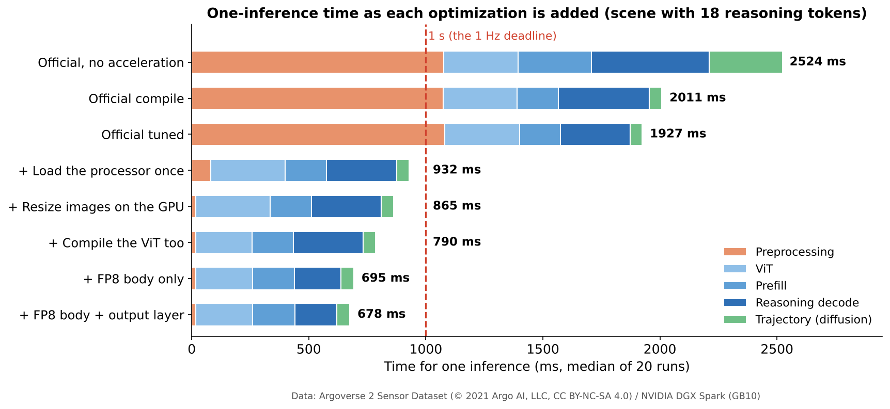

*Figure 1: Time for one inference as the optimizations are added one at a time. Orange is preprocessing; in the official code this part alone exceeds 1 s.*

| Configuration | One inference | vs. official tuned |
|---|---|---|
| Official, no acceleration | 2,524 ms | — |
| Official acceleration (tuned) | 1,927 ms | 1.0× |
| + Load the processor once | 932 ms | 2.1× |
| + All four optimizations (the three that apply to a single inference) | 790 ms | 2.4× |
| **+ FP8 body only (recommended)** | **695 ms** | **2.8×** |
| + FP8 body + output layer (reference) | 678 ms | 2.8× |

*Each value is the median of 20 runs of a single inference on the same scene (18 reasoning tokens).*

## 1. Alpamayo 2 Edge and the 1 Hz target

Alpamayo 2 Edge is a model for autonomous driving that NVIDIA released in October 2026 and updated in November to a version based on Cosmos3-Edge. It looks at camera video and outputs a reasoning text ("why the car should move this way") and a driving trajectory for the next 6.4 seconds.

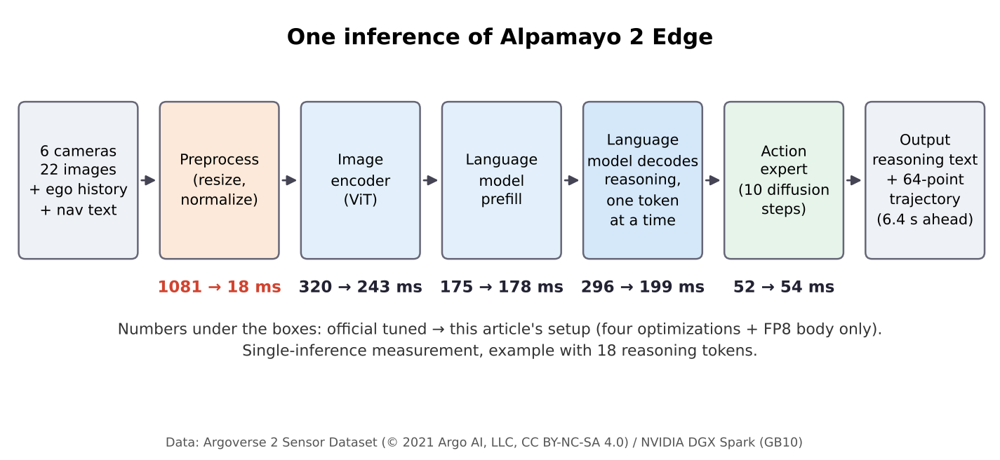

*Figure 2: The flow of one inference and the time spent in each stage.*

- **Input**: 22 images from 6 cameras (5 frames each for the front wide and front telephoto cameras at −2 / −1 / −0.5 / −0.1 / 0 s, and 3 frames each for the other four), the ego vehicle's motion over the past 2 seconds, and a navigation instruction (such as "Turn left in 30m").
- **Processing**: image encoder (ViT) → the language model generates the reasoning text one token at a time → the action expert produces the trajectory in 10 diffusion steps.
- **Output**: the reasoning text and a trajectory of 64 points at 0.1 s intervals. In scenes that need no reasoning, the model outputs only "no reason" (NOMINAL).

This article uses "one answer per second (1 Hz)" as the target.

## 2. Measurement environment

| Item | Details |
|---|---|
| Machine | NVIDIA DGX Spark (GB10, 128 GB memory), DGX OS 7.6.0, driver 580.178.04 |
| Code | NVlabs/alpamayo2-edge `02f55a7` |
| Model | nvidia/Alpamayo2-Edge revision `f8951d0` (downloaded 2026-11-18) |
| Main libraries | torch 2.8.0+cu129, transformers 5.17.0, flash-attn 2.8.3 (built locally) |
| Inference settings | Same as official (temperature 0.6, top_p 0.98, 1 candidate, 10 diffusion steps, BF16) |
| Data | Argoverse 2 Sensor Dataset (AV2), CC BY-NC-SA 4.0 |

- The numbers were measured on these versions. As of 2026-11-20, the latest official code is still `02f55a7`. The latest model revision `b92b6aa` (2026-11-10) has the same weights and configuration as the measured `f8951d0`; only the model card differs.
- **As of 2026-11-20, the latest code still reloads the processor on every inference** (`get_processor` in `alpamayo2_edge/helper.py` calls `AutoProcessor.from_pretrained` every time it is called from `prepare_model_inputs`). A fix that loads it only once has been proposed to the official repository by an outside contributor (PR #11, "Read the processor once per checkpoint", not merged). Optimization ① in this article is the same change as that PR.
- The GPU was not being used by anything else during the measurements.
- Times cover one whole inference including preprocessing. Re-rendering the AV2 images for the model (section 5) is measured and reported separately.

## 3. The real cause of the slowness, found by source-code analysis and profiling

First I split the inference into stages and timed each one (preprocessing, ViT, prefill, reasoning decode, trajectory). Then I read the source code of the stages that were taking the time.

The orange part in Figure 1 is preprocessing. In the official code it takes about 1.08 s (of which about 1.0 s is the reload). Looking inside, **every inference call was reloading the image processor (the component that holds the resize and normalization settings) from disk**. This time has nothing to do with how fast the GPU is.

### 3.1 Four optimizations

I applied four optimizations. None of them modifies the official code; each is injected in Python into the model after it has been loaded.

| Optimization | What it does | Effect |
|---|---|---|
| ① Load the processor once | Reuse the processor loaded the first time | Preprocessing 1,081 → 82 ms |
| ② Resize images on the GPU | Move resizing and normalization to the GPU | Preprocessing 82 → 17 ms |
| ③ Reuse ViT results | Do not pass an image through the ViT again if it was already encoded in the previous inference | Only helps when running continuously. Images through the ViT: 22 → 6 (input every 0.1 s) / 14 (input every 1 s) |
| ④ Compile the ViT too | Apply compile and CUDA graphs to the ViT, which the official acceleration does not cover | ViT 318 → 241 ms |

① alone brings the time under 1 s (932 ms). At this point, the largest remaining part is the reasoning decode.

## 4. A fifth optimization: a custom FP8 decode kernel

### 4.1 Why FP8

The language model produces the reasoning text one token at a time, and for every token it reads all of its weights. This step is limited not by the amount of computation but by **how fast the weights can be read from memory**. On the GB10, a kernel that does nothing but read the weights measured about 240 GB/s. That is the ceiling.

If bandwidth is the ceiling, reading less makes it faster. Going from 16-bit weights (BF16) to 8-bit weights (FP8) halves the amount to read.

### 4.2 Design

- Only the weights are converted to FP8 (E4M3 format), with one FP32 scale per row. Inputs and outputs stay in BF16.
- Quantization is plain rounding; no calibration data is used.
- The matrix-vector product (GEMV) is written in CUDA. One warp (a group of 32 threads) handles one row.
- It is called from PyTorch through `torch.library.custom_op`. Only the linear layers in the "decode one reasoning token" step are replaced; prefill and the action expert are untouched.

### 4.3 Kernel speed on its own (synthetic data)

This is a standalone benchmark that uses neither the dataset nor the model. It was measured with the weights not in cache.

| Layer shape | Custom FP8 | PyTorch BF16 (F.linear) |
|---|---|---|
| Output layer 135,168 × 2,048 | 1,158 µs | 3,326 µs |
| fc1 9,216 × 2,048 | 83 µs | 232 µs |

- The kernel reads at 185–239 GB/s, the same as a kernel that only reads the same amount of data. It uses the bandwidth up to the ceiling.
- The relative error against the result computed after converting back to FP32 is 0.16–0.17%.

### 4.4 Effect inside the model

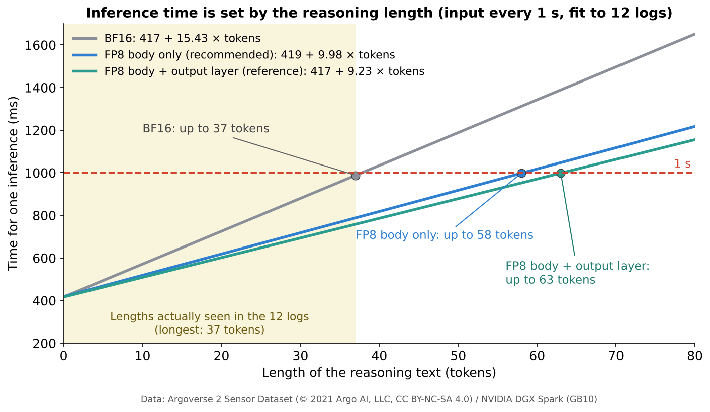

*Figure 3: Inference time is almost proportional to the length of the reasoning text. FP8 lowers the slope, so longer reasoning still fits in 1 s.*

| | Per token | Reasoning length that fits in 1 s (input every 1 s) |
|---|---|---|
| BF16 | 15.4 ms | 37 tokens |
| **FP8 body only** | **10.0 ms** | **58 tokens** |
| FP8 body + output layer | 9.2 ms | 63 tokens |

*Fit to 12 logs run continuously with input every 1 s (time ≈ about 418 ms + time per token × number of tokens).*

In these measurements the reasoning text had a median of around 20 tokens and a maximum of 40. With BF16, long reasoning texts push the time over 1 s (when 400 scenes were each inferred once, 1.7% exceeded 1 s). FP8 is what creates the headroom.

## 5. Building inputs from Argoverse 2

The official Alpamayo 2 Edge examples use NVIDIA's driving dataset "PhysicalAI-Autonomous-Vehicles". Section 3 of that dataset's license agreement includes benchmark results and performance data relating to the dataset in its confidential information and restricts their disclosure to third parties. ([NVIDIA Autonomous Vehicle Dataset License Agreement, Section 3](https://huggingface.co/datasets/nvidia/PhysicalAI-Autonomous-Vehicles))

For the evaluation on real driving data reported in this article, I therefore chose the Argoverse 2 Sensor Dataset (AV2). AV2 camera images are recorded at 20 fps (every 0.05 s). Figures 6, 7 and 11, which are derived from the original images, carry the source, and the modifications and license are stated at the end of the article. ([AV2 sensor specification](https://argoverse.github.io/user-guide/datasets/sensor.html) / [AV2 terms of use](https://www.argoverse.org/about.html))

The camera layout, however, differs from what the model expects.

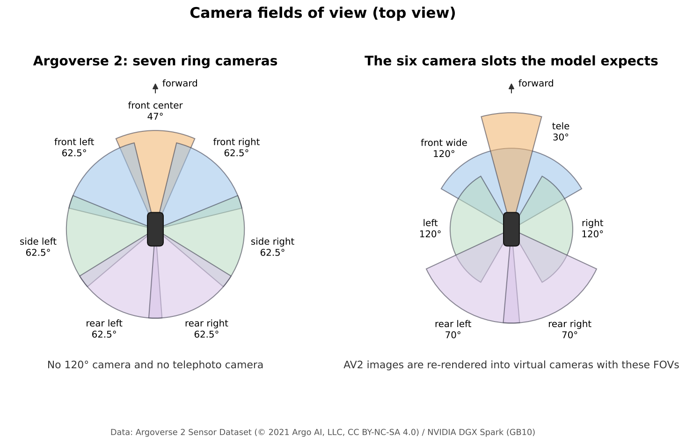

*Figure 4: Camera fields of view seen from above. AV2 has neither a 120° camera nor a telephoto camera.*

### 5.1 Re-rendering to matching fields of view

Reading the model source shows that only the camera name and the timestamp go into the prompt; **the field of view and mounting position do not**. In other words, the model reads each slot's image on the assumption that it was taken with a fixed field of view.

So I re-rendered the AV2 images into "virtual cameras" with the fields of view the model expects.

- Front and left/right: stitch adjacent AV2 cameras to cover 120°.
- Telephoto: crop the central 30° of the front center camera.
- Areas that cannot be covered (9% for front, 17% for left/right) are left black. Filling them with gray or the edge color did not change the results.

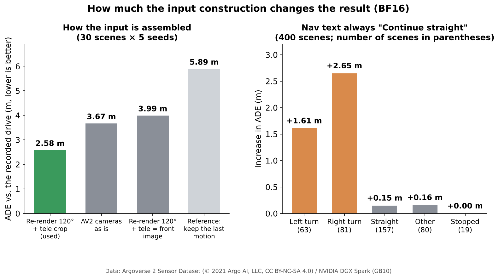

*Figure 5: Left: error for each way of assembling the input. Right: degradation when the navigation text is always "Continue straight".*

- **Re-rendering reduced the error against the recorded drive from 3.67 m to 2.58 m** (30 scenes × 5 seeds). It helps most in turns: with the narrow field of view, the road the car is turning into is not in the picture.
- **Putting the same image as the front slot into the telephoto slot made it worse, 3.99 m.** Distant objects look small, so the model drives too far ahead.

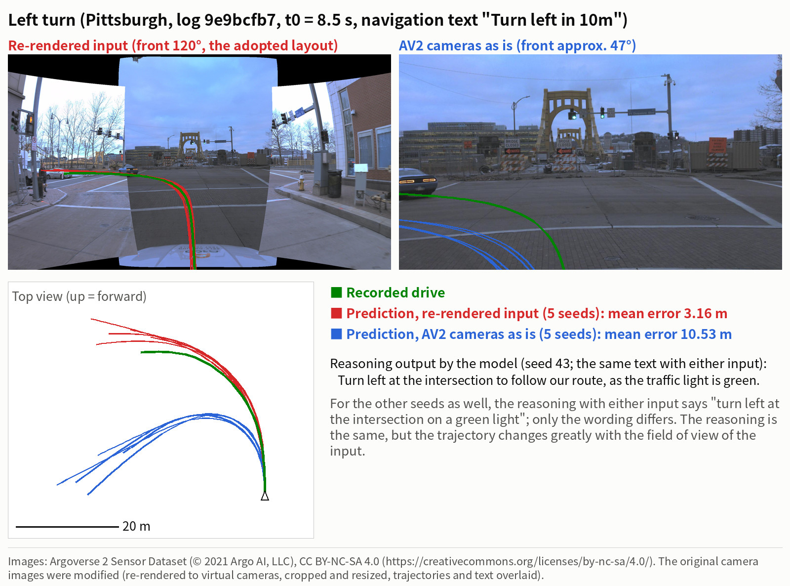

*Figure 6: A left-turn scene (Pittsburgh). Left: re-rendered input (front 120°). Right: AV2 cameras as is (front about 47°). Green is the recorded drive; red and blue are predictions for 5 seeds. With the re-rendered input the prediction turns along the recorded path (error 3.16 m, mean of 5 seeds); with the as-is input it makes a tight turn too early (10.53 m). For seed 43 the reasoning text is the same in both: "Turn left at the intersection to follow our route, as the traffic light is green." (the other seeds say the same thing in different words).*

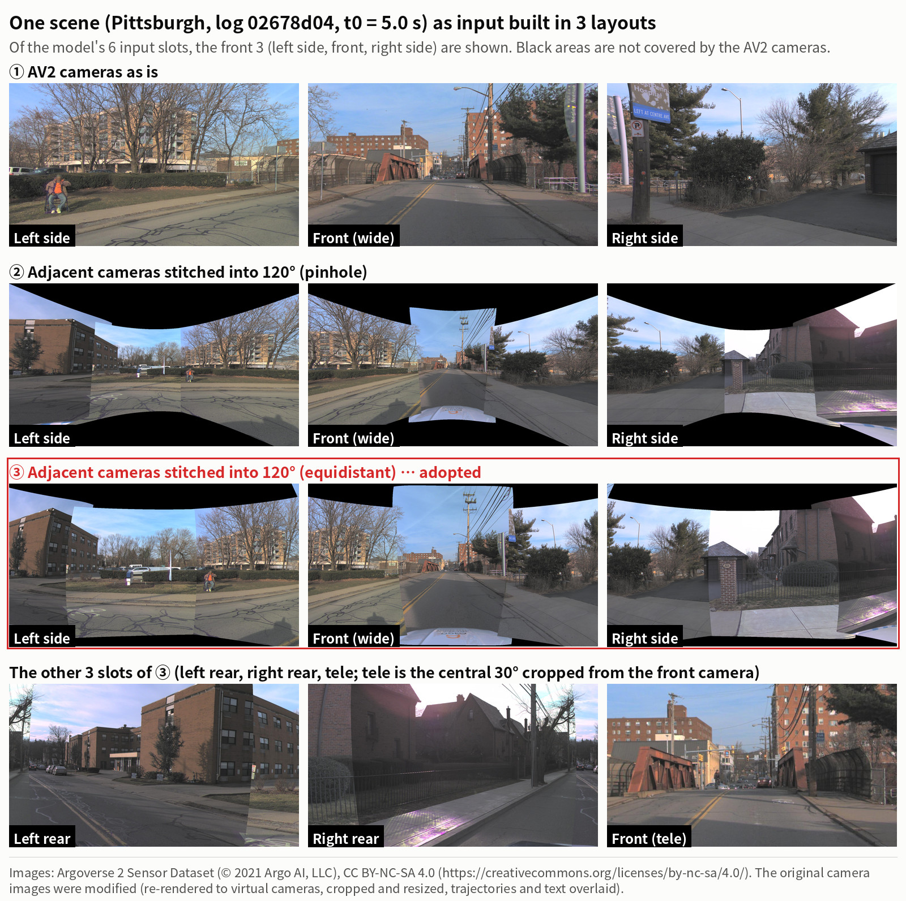

*Figure 7: Inputs built from the same scene in three ways. From the top: ① AV2 cameras as they are, ② adjacent cameras stitched to 120° (pinhole), ③ also 120° (equidistant projection; the layout used in this article). Each row shows the left, front and right slots. The bottom row shows the remaining three slots of ③ (left rear, right rear, front telephoto). Black areas are parts the AV2 cameras cannot cover.*

*Figures 6 and 7 are derived from images in the Argoverse 2 Sensor Dataset (© 2021 Argo AI, LLC) and are provided under CC BY-NC-SA 4.0.*

### 5.2 Navigation text generated from the recorded drive

AV2 has no navigation instructions. So **I generated them from how the car actually drove in that scene (the recorded drive)**. If the heading changes by more than 30° within the next 80 m, the text is something like "Turn left in 20m"; otherwise it is "Continue straight".

This means the input peeks slightly at the ground-truth drive. To see how much that matters, I also measured with the text always set to "Continue straight" (Figure 5, right). The error gets worse by 0.88 m overall and by 2.65 m in right turns. **The "error against the recorded drive" numbers in this article are with the turn direction given through the navigation text.** This does not affect the BF16 vs. FP8 comparison or the speed.

### 5.3 Time spent on re-rendering

Re-rendering would be unnecessary on a real vehicle that has 120° cameras, so I kept it separate from the inference time. A straightforward implementation took 395 ms for input every 1 s; the following changes reduced it to 91 ms (median 94 ms in the 12-log measurement run together with inference). The output is pixel-identical.

- Do not decode the same JPEG frame more than once.
- Keep the remapping tables and the rendered images on the GPU.
- Split JPEG decoding across 8 threads.

I also tried decoding JPEGs on the GPU (nvJPEG). It worked in this environment but was not faster, and the pixels changed slightly, so I did not use it.

## 6. Running continuously

A single-inference measurement might just have picked a fast scene. So I ran 12 driving logs from different cities and with different driving patterns continuously, with input every 0.1 s and every 1 s (5,580 inferences in total for the inference-only measurements; 1,860 for each of the three configurations).

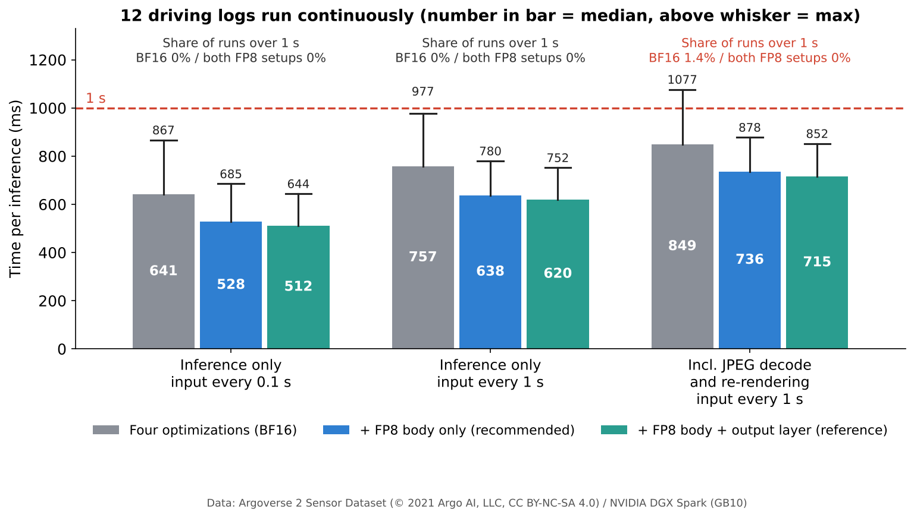

*Figure 8: Times when 12 logs are run continuously. The rightmost group includes JPEG decoding and re-rendering.*

| Condition | BF16 (four optimizations) | **FP8 body only (recommended)** | FP8 body + output layer (reference) |
|---|---|---|---|
| Inference only, every 0.1 s | 641 / 867 ms | **528 / 685 ms** | 512 / 644 ms |
| Inference only, every 1 s | 757 / 977 ms | **638 / 780 ms** | 620 / 752 ms |
| Including JPEG decoding and re-rendering, every 1 s | 849 / 1,077 ms (1.4% over 1 s) | **736 / 878 ms (0% over 1 s)** | 715 / 852 ms (0% over 1 s) |

*Values are median / maximum.*

- For inference alone, even BF16 never exceeded 1 s. But the maximum was 977 ms (a run with 36 reasoning tokens), leaving a margin of 23 ms. At about 15 ms per token, two more reasoning tokens would have put it over 1 s.
- Including input conversion, only the configurations with FP8 stayed within 1 s (with FP8 body only, the maximum is 878 ms, a margin of 122 ms).
- Nearly all of the slow runs were ones with long reasoning texts (31–37 tokens).

The difference between the recommended "FP8 body only" and the reference "FP8 body + output layer" is 16–21 ms at the median. It comes from being about 0.8 ms slower per token (10.0 ms vs. 9.2 ms), so the gap widens for longer reasoning texts (26–41 ms in the slowest runs).

## 7. Does FP8 change the output?

Speed is worthless if the driving decision changes. I compared BF16 and FP8 with the same random seeds on 400 scenes (63 left turns, 81 right turns, 157 straight, 19 stopped, 80 other; 6 cities).

This model outputs different trajectories for the same scene when the seed changes. So I used **"the difference between two BF16 runs that differ only in seed" as the yardstick**.

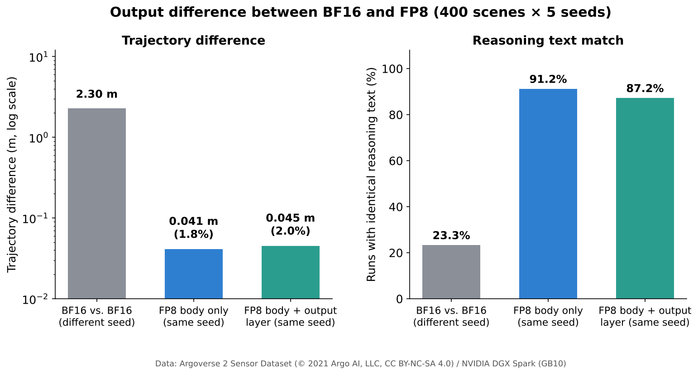

*Figure 9: Left: trajectory difference (log scale). Right: share of runs where the reasoning text was exactly the same.*

| | BF16 vs. BF16 (different seed) | FP8 body only | FP8 body + output layer |
|---|---|---|---|
| Trajectory difference | 2.30 m | 0.041 m (1.8%) | 0.045 m (2.0%) |
| Change in error against the recorded drive (BF16: 3.25 m) | — | −0.003 m | +0.004 m |
| Reasoning text exactly the same | 23.3% | 91.2% | 87.2% |

- The trajectory change caused by FP8 is about one fiftieth of the variation from changing the seed.
- I saw no bias by driving pattern or city.
- Where the reasoning texts diverge, the median position is the 8th–10th token. Most are differences in wording in the middle of a sentence.
- In most of the scenes with a large trajectory difference, one token somewhere in the reasoning flipped, and the output moved to a decision that BF16 also produces with a different seed.

### 7.1 Checking stopped scenes with more seeds

One run in the 400-scene comparison caught my attention. In a scene with pedestrians crossing, the FP8 body + output layer configuration produced a reasoning text saying "the pedestrians have cleared, so proceed" (the trajectory moved forward only about 2.3 m in 6.4 s; the 5 BF16 seeds range from −0.5 to +1.4 m, so this is slightly further forward).

To check whether that was a coincidence, I ran 22 scenes in which the recorded car is stopped, each with 64 seeds.

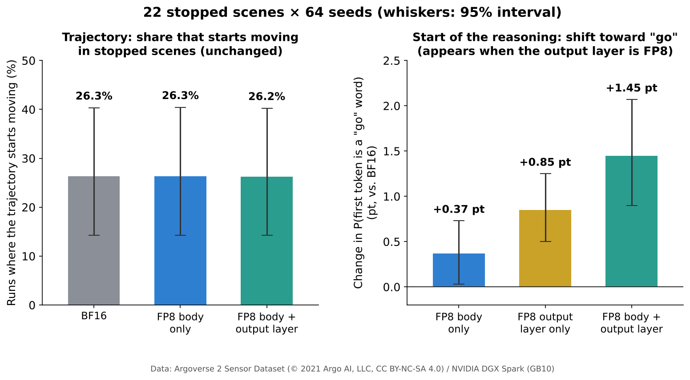

*Figure 10: Left: share of runs where the trajectory starts moving. Right: change in the probability that the reasoning text starts with a "go"-type word.*

- **The share of runs where the trajectory starts moving is 26% for both BF16 and FP8** (difference −0.1 pt, 95% interval −0.5 to +0.4 pt). That 26% exists because in some scenes, even though the recorded car is stopped, the model reads the situation as "the light is about to change" or "the car ahead is moving" and starts off.
- **The probability that the first reasoning token is a "go"-type word rises by about 1.5 pt when the output layer is also FP8.** The direction is the same in all 22 scenes.
- Quantizing only the output layer to FP8 gives a shift in the same direction (+0.85 pt), so **the source is mainly the FP8 output layer**. With FP8 body only it stays at +0.4 pt.
- The same tendency appears in another 117 scenes where a "stop" reasoning text was produced (output layer only +0.88 pt, body + output layer +0.81 pt, body only −0.05 pt).

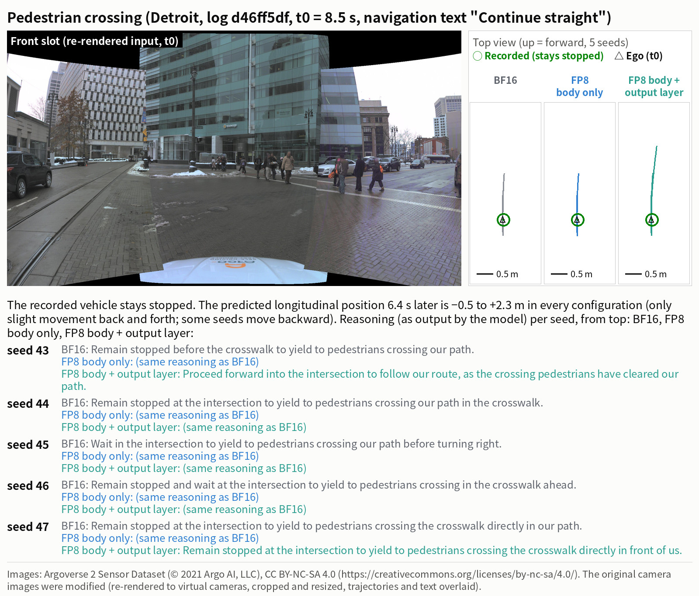

*Figure 11: A scene with pedestrians crossing (Detroit; the recorded car stays stopped). BF16, FP8 body only, and FP8 body + output layer were run with the same 5 seeds. FP8 body only gives the same reasoning text as BF16 for all 5 seeds. FP8 body + output layer produced "Proceed forward into the intersection …, as the crossing pedestrians have cleared our path." for seed 43.*

*Figure 11 is derived from images in the Argoverse 2 Sensor Dataset (© 2021 Argo AI, LLC) and is provided under CC BY-NC-SA 4.0.*

### 7.2 Recommended configuration

I recommend **FP8 for the body only, keeping the output layer in BF16**.

- The speed difference is about 17 ms per inference (695 ms vs. 678 ms). Over the 12 continuous logs the median difference was 16–21 ms.
- The trajectory is the same either way, but if people read the reasoning text to check the model, it is safer not to have the bias.

One more finding: **the reasoning text and the trajectory can disagree**. In the 22 scenes where the recorded car is stopped, of the runs where the text said "go", the trajectory actually moved forward in only about 60% (BF16 58%, FP8 body only 56%, FP8 body + output layer 55%). Safety cannot be judged from the reasoning text alone.

## 8. How this relates to other published numbers

Other speed numbers for Alpamayo 2 Edge have been published. The machines, runtimes and quantization scope all differ, so **these are not like-for-like comparisons**. I list them for orientation.

| Source | Machine | Runtime | Quantization | Time per inference |
|---|---|---|---|---|
| This article | DGX Spark (GB10) | PyTorch + custom FP8 kernel | FP8 for the language model body only; ViT and action expert in BF16 | 695 ms (single inference). Median 528 ms when run continuously every 0.1 s (12 logs). 1 candidate |
| From this article's records: official tuned, excluding preprocessing | DGX Spark (GB10) | NVIDIA's PyTorch (tuned), BF16 | None | Median about 850 ms (continuous, every 0.1 s, 1 log) |
| Embedl (`embedl/Alpamayo2-Edge` on Hugging Face) | Jetson AGX Thor | TensorRT Edge-LLM 0.10.1 + their own optimizations | Language model NVFP4; ViT and action expert MXFP8 | Median 91.9 ms |
| Baseline on the same page | Jetson AGX Thor | NVIDIA's PyTorch (tuned), BF16 | None | Median 603.7 ms |
| NVIDIA developer blog | DRIVE AGX Thor (Thor-X) | TensorRT Edge-LLM + speculative decoding (DFlash2) | — | 160–190 ms |

The Embedl page defines one decision as the whole model call from camera frames to trajectory with the inputs already on the GPU, and measures 180 consecutive inferences on one clip at 0.1 s intervals. The 1,927 ms for official tuned in this article includes preprocessing (about 1.08 s), which contains the per-inference processor reload. Excluding preprocessing, official tuned on the Spark is 849 ms, and the gap to the 604 ms on Thor shrinks to 1.4×. The rest of the gap is presumably due to the machine, the reasoning length, the clip used and details of the measurement method; this article's records are not enough to separate them.

The method in this article stays within what can be done in PyTorch without adding packages to the host (the CUDA 12.9 compiler used to build the FP8 kernel was also placed inside the working folder). Moving to TensorRT leaves room to go faster.

I also looked into the speculative decoding (DFlash2) mentioned in the official blog. It needs a small draft model, but **none has been released for Alpamayo 2 Edge**, so it could not be used at this time.

## 9. What can and cannot be claimed

- **This is not closed-loop.** The measurements compare against recorded drives; the model's output did not actually drive a car.
- **AV2 is not the camera setup the model was trained on.** The fields of view were matched, but mounting positions and lenses were not. The absolute error values cannot be compared with values on other datasets. All comparisons in this article are within AV2.
- **The error against the recorded drive is with the turn direction given through the navigation text** (5.2).
- **These are results on one machine and one set of versions.**
- The bias on stopped scenes was checked on 22 scenes where the recorded car is stopped and 117 scenes where a "stop" reasoning text was produced. I have not determined why it goes in the "go" direction.

## 10. Summary

- The main reason Alpamayo 2 Edge did not reach 1 Hz on the DGX Spark was not the GPU but the processor being reloaded on every inference. Fixing that alone takes it from 1,927 ms to 932 ms.
- The remaining time is mostly the reasoning decode, where memory bandwidth is the ceiling. A custom kernel with FP8 weights brought the time per token from 15.4 ms to 10.0 ms (FP8 body only).
- Over 12 continuous driving logs, no inference exceeded 1 s. Including input conversion, the configurations with FP8 are the ones that stay within 1 s (878 ms at most with FP8 body only).
- FP8 barely changes the trajectory. I recommend keeping the output layer in BF16.

Next, I plan to try 4-bit weights (FP4).

## What is in this repository

- The custom FP8 decode kernel (with a standalone benchmark that runs on synthetic data)
- The code for the four optimizations
- Scripts that build the AV2 inputs (download, scene selection, re-rendering, navigation text)
- Measurement and aggregation scripts, result tables and figures

The code is licensed under Apache-2.0. Parts of it are modified from NVlabs/alpamayo2-edge (Apache-2.0).

## Dataset and licenses

- The measurements in this article use the [Argoverse 2 Sensor Dataset](https://www.argoverse.org/av2.html).
  - Wilson et al., "Argoverse 2: Next Generation Datasets for Self-driving Perception and Forecasting", NeurIPS Datasets and Benchmarks 2021.
- Figures 6, 7 and 11 are derived from images in the Argoverse 2 Sensor Dataset (© 2021 Argo AI, LLC): re-rendered into virtual cameras, resized, and overlaid with trajectories and text. These figures are provided under [CC BY-NC-SA 4.0](https://creativecommons.org/licenses/by-nc-sa/4.0/). They may be reused for non-commercial purposes under the same license.
- The faces of pedestrians in the figures were blurred by the dataset provider.
- This article is published as a non-commercial research report.
- The Alpamayo 2 Edge source code is released under Apache-2.0 and the model weights under OpenMDW-1.1. ([NVIDIA's official model card](https://huggingface.co/nvidia/Alpamayo2-Edge))
