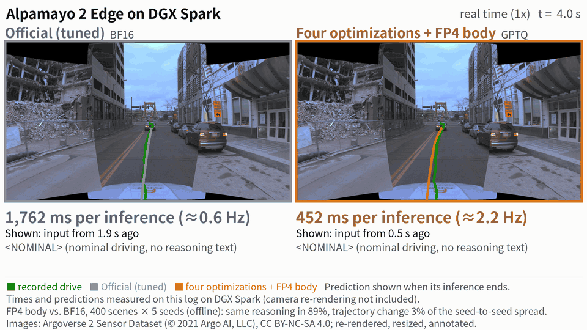
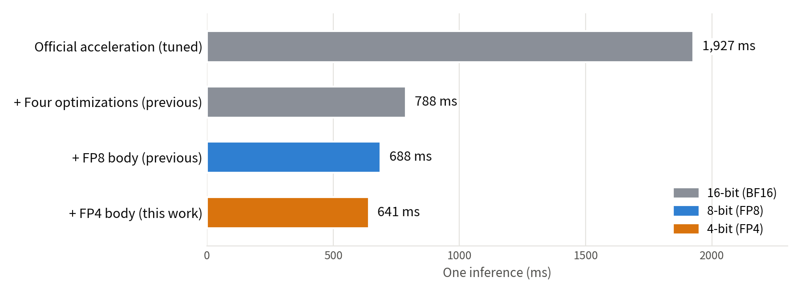
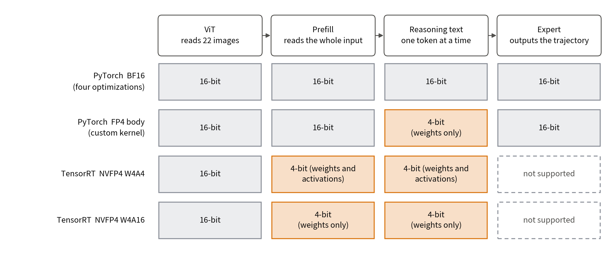
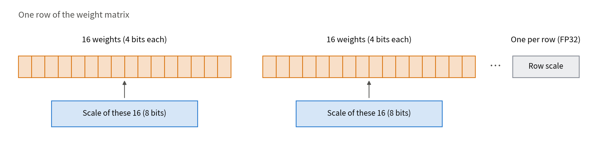
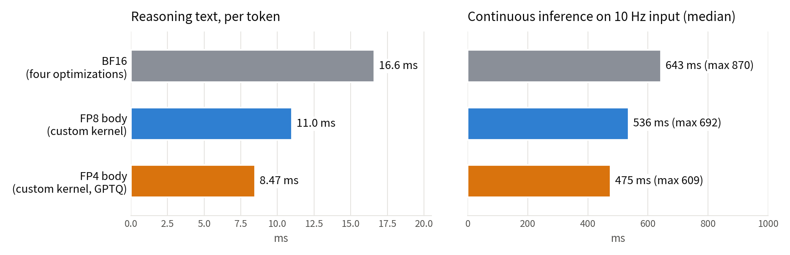
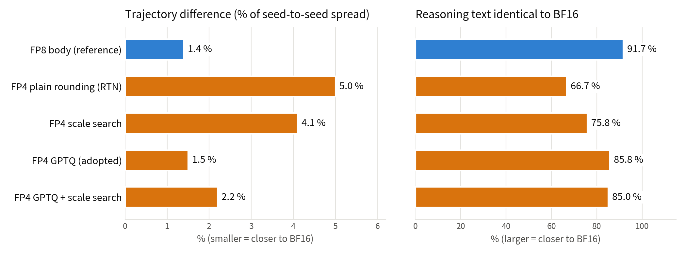
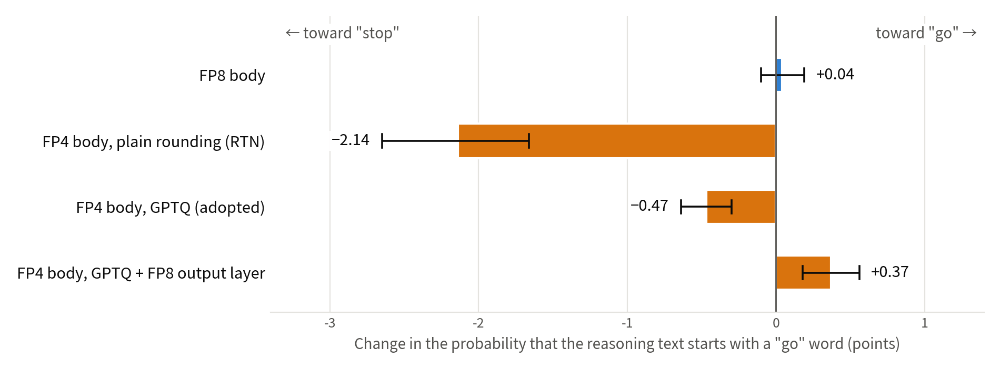
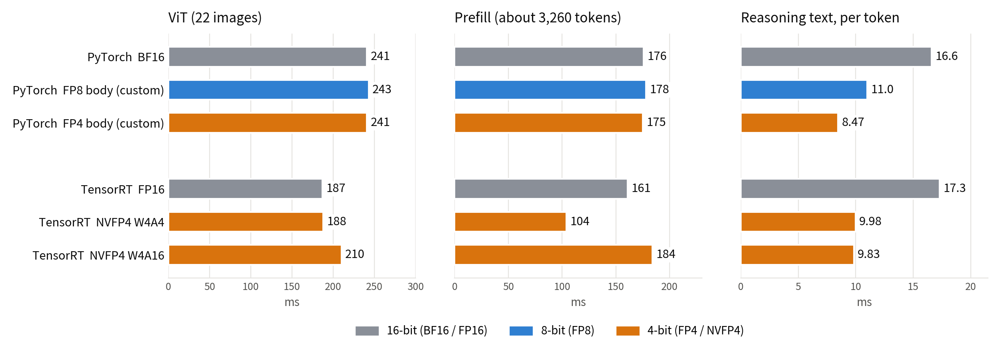
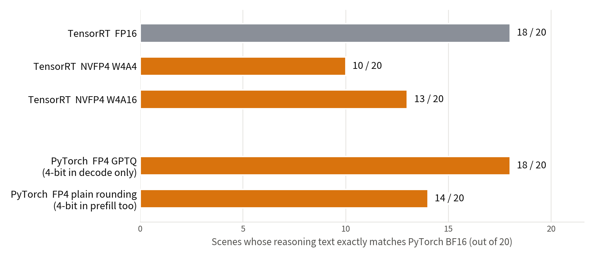
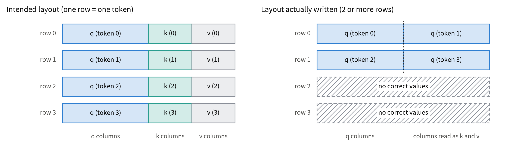

# Autonomous-driving AI "Alpamayo 2 Edge" (2): FP4 kernel tuning and a TensorRT Edge-LLM comparison on DGX Spark

> English version of the article published on Qiita (Japanese) on 2026-11-22:
> <https://qiita.com/nabe2030/items/6b71bfbfd04b06599240>
>
> All numbers are as measured on the software versions listed in section 2.

## TL;DR

- This is a follow-up to the [previous article](article_en.md) ([Japanese on Qiita](https://qiita.com/nabe2030/items/f220eb860dda549e966d)). I ran NVIDIA's autonomous-driving model Alpamayo 2 Edge on an NVIDIA DGX Spark (GB10 / 128 GB), and this time tried 4-bit quantization and TensorRT Edge-LLM.
- **The guess "GB10 is Blackwell, so 4 bits should pay off" turned out to be right.** How much it helps, however, depends on the stage.
- **With a custom FP4 kernel, one inference went from 1.9 s (0.5 Hz) to 0.64 s (1.6 Hz), 3.0× faster.** The baseline is the official acceleration (tuned). That is one more step beyond where the previous article ended (FP8 body, 2.8× faster). Measured on the same day: BF16 788 ms, FP8 688 ms, FP4 641 ms; generating the reasoning text takes 16.6 → 11.0 → 8.47 ms per token.
- **4 bits need calibration.** With plain round-to-nearest (RTN), the share of reasoning texts identical to BF16 drops to 67%, and the start of the reasoning leans toward "stop". With GPTQ calibrated on 48 Argoverse 2 logs, it comes back close to FP8.
- **TensorRT Edge-LLM runs on the Spark.** TensorRT is faster for the ViT and the prefill; the custom FP4 kernel is faster for generating the reasoning text.
- **TensorRT Edge-LLM's "weights-only 4-bit" (W4A16) produced broken output as shipped.** The cause is in the compiler of TensorRT itself, and adding one line to the builder makes it work. I filed two issues with NVIDIA.

*The same driving log played in real time; when the previous inference ends, the next one starts on the latest input at that moment. Left: official acceleration (tuned), 1,858 ms per inference. Right: this article's setup (the four optimizations + FP4 body), 612 ms (medians). During these 11 seconds, 7 inferences finished on the left and 23 on the right. The trajectory and the reasoning switch when an inference finishes. The times are as measured when this video was recorded. Running continuously lets part of the ViT results be reused, so the right side comes out a little faster than the representative value in the text (641 ms). Images are re-rendered from the Argoverse 2 Sensor Dataset (© 2021 Argo AI, LLC, CC BY-NC-SA 4.0).*

*Figure 1: Time for one inference, from where the previous article ended (FP8 body) to this article's FP4 body.*

| Setup | One inference | vs. official tuned |
|---|---|---|
| Official acceleration (tuned) | 1,927 ms | 1.0× |
| + four optimizations | 788 ms | 2.4× |
| + FP8 body (end of the previous article) | 688 ms | 2.8× |
| **+ FP4 body (this article)** | **641 ms** | **3.0×** |

*Same scene, 18 tokens of reasoning, median of 20 runs. Official tuned is the value from the previous article; the other three were measured again on the same day for this article (the previous article had 790 ms and 695 ms).*

## 1. The two things tried this time

There are two things to do this time.

- **Make the custom kernel 4-bit (FP4) and measure the speed and how the output changes.** The GB10 in the DGX Spark is a Blackwell-generation GPU and supports 4-bit arithmetic. Then 4-bit quantization should pay off — that guess is the starting point.
- **Run NVIDIA's inference runtime TensorRT Edge-LLM on the same Spark with the same inputs, and compare it with the custom kernel.** "Wouldn't TensorRT make it even faster?" was homework left over from the previous article.

One inference of Alpamayo 2 Edge has four stages. The ViT reads the camera images; the language model reads them together with the navigation instruction and other inputs in one go (prefill); it outputs, one token at a time, the reasoning text that says why it drives that way; and finally the expert outputs the trajectory.

*Figure 2: The four stages of an inference, and the number of bits each compared setup computes with.*

| Setup | Runtime | What is made 4-bit | Calibration |
|---|---|---|---|
| BF16 (four optimizations) | PyTorch | nothing | — |
| FP4 body | PyTorch + custom kernel | weights only, in reasoning-text generation | GPTQ (48 AV2 logs) |
| NVFP4 W4A4 | TensorRT Edge-LLM | weights and activations, in prefill and reasoning-text generation | ModelOpt (32 AV2 scenes) |
| NVFP4 W4A16 | TensorRT Edge-LLM | weights only, in prefill and reasoning-text generation | same |

*"Activations" are the data that go into a layer. TensorRT Edge-LLM has no implementation of the expert and cannot output trajectories (section 5).*

## 2. Measurement environment

| Item | Details |
|---|---|
| Machine | NVIDIA DGX Spark (GB10, 128 GB memory), DGX OS 7.6.0, driver 580.178.04 |
| Code | `NVlabs/alpamayo2-edge` `02f55a7` |
| Model | `nvidia/Alpamayo2-Edge` `f8951d0` |
| PyTorch side | torch 2.8.0+cu129, transformers 5.17.0, flash-attn 2.8.3 (built ourselves), nvcc of CUDA 12.9 |
| TensorRT side | TensorRT Edge-LLM 0.12.0, TensorRT 10.16.1.11, ModelOpt 0.45.0 |
| Data | Argoverse 2 Sensor Dataset (AV2). The same 400 scenes as last time, and subsets of them |

- Speed was measured with the GPU not used for anything else.
- "The four optimizations" are the four in section 3.1 of the previous article (load the processor only once, resize the images on the GPU, reuse ViT results, use compile and CUDA graphs for the ViT too). They are included in every setup in this article.

## 3. A custom FP4 decode kernel

### 3.1 Why 4 bits

The starting point is a guess from the hardware. NVIDIA advertises the DGX Spark as delivering "[up to 1 petaFLOP of FP4](https://www.nvidia.com/en-us/products/workstations/dgx-spark/)" (a theoretical value using sparsity). The GB10 is a Blackwell-generation GPU with arithmetic units and instructions that handle 4-bit floating point (FP4). So 4 bits should pay off for this model too — that was the idea.

The other reason is the previous result. The reasoning text is generated one token at a time, and every token reads all the weights of the language model. On the Spark, this reading is capped by memory bandwidth (about 240 GB/s). Smaller weights make it faster by that much. Last time I went from 16 bits (BF16) to 8 bits (FP8). This time I go further, to 4 bits.

Whether the guess was right is summarized in section 7.

### 3.2 Implementation

*Figure 3: Storage format of the weights of the custom FP4 kernel. It is close to NVIDIA's NVFP4.*

| Item | Details |
|---|---|
| Weights | 4-bit floating point (E2M1), two elements packed in one byte |
| Scales | 8 bits (E4M3) per 16 elements, FP32 per row |
| Bits per element | BF16 16 bits, FP8 8 bits, FP4 4.5 bits (4 + 8 ÷ 16) |
| Weights of the 28 body layers | about 2.8 GB in BF16 become 795 MB |
| Target | qkv, o, fc1 and fc2 of the 28 body layers of the language model. The output layer stays BF16 |
| Scope | Reasoning-text generation only. Prefill stays BF16 |
| Call | Called as a PyTorch op from inside the CUDA graph of the official acceleration (tuned) |

There was one pitfall. The GPU instruction that converts 4 bits back to 16 bits is emitted only when compiling for `sm_121a`. With plain `sm_121`, the same code becomes a software conversion and is not faster.

### 3.3 Speed

*Figure 4: Time per token of reasoning-text generation, and time per inference when inferring continuously on 10 Hz input.*

| Setup | One inference | Reasoning text (per token) | Continuous at 10 Hz (median / max) | Continuous at 1 Hz (median / max) |
|---|---|---|---|---|
| BF16 (four optimizations) | 788 ms | 16.6 ms | 643 / 870 ms | 758 / 973 ms |
| FP8 body | 688 ms | 11.0 ms | 536 / 692 ms | 636 / 782 ms |
| **FP4 body (GPTQ)** | **641 ms** | **8.47 ms** | **475 / 609 ms** | **581 / 693 ms** |

*One inference includes preprocessing and the expert. Continuous means running 12 logs; 1,428 inferences at 10 Hz and 432 at 1 Hz.*

- On its own, the kernel reads the 28 body layers in 3.59 ms per token (FP8: 6.06 ms), at 221 GB/s. That is 89% of the 249 GB/s reached by the fastest shape.
- The rest of the 8.47 ms is reading the output layer, which stays BF16 (about 2.3 ms), plus attention, sampling and so on.
- The length of the reasoning text varies by scene. Measured over 400 scenes, **the reasoning length that fits within 1 second is 31 tokens with BF16, 47 tokens with FP8 and 62 tokens with FP4**. 90% of the actual reasoning texts are 27 tokens or shorter, so with FP8 and FP4 no run exceeded 1 second (with BF16, 97.9% were under 1 second).

## 4. Does the output change with 4 bits?

### 4.1 Rounding alone changes the reasoning text

With FP8, simply rounding each weight to the nearest value (round-to-nearest, RTN) hardly changed the output. With 4 bits things are different.

*Figure 5: How the output changes for each way of rounding. 40 scenes × 3 seeds. The output layer is BF16 in all of them.*

The yardstick is the same as last time. Even BF16 runs give different trajectories when the seed changes, so the "difference when changing the seed" is taken as 100%, and the difference caused by quantization is expressed as a percentage of it.

| Body weights | Trajectory difference | Change in error vs. the recorded drive | Reasoning text identical to BF16 |
|---|---|---|---|
| FP8 (for comparison) | 1.4% | +0.002 m | 91.7% |
| FP4, plain rounding (RTN) | 5.0% | +0.049 m | 66.7% |
| FP4, scale search | 4.1% | +0.043 m | 75.8% |
| **FP4, GPTQ** | **1.5%** | **−0.005 m** | **85.8%** |
| FP4, GPTQ + scale search | 2.2% | +0.035 m | 85.0% |

*Between BF16 runs with different seeds, the reasoning text is identical 12.5% of the time.*

With plain rounding, the trajectory difference is 3.6 times that of FP8, and the reasoning text changes once in three times.

### 4.2 Calibrating with GPTQ

GPTQ runs real data through the model to collect statistics of each layer's input, then rounds one column at a time while cancelling the rounding error with the remaining weights.

| Item | Details |
|---|---|
| Calibration data | 48 AV2 train logs not used in the 400 evaluation scenes (straight 14, left turn 10, right turn 10, stop 7, other 7). 5,468 tokens' worth |
| Checking for overfitting | Measured again on another 48 logs not used for calibration, the error is 1/6 to 1/10 of plain rounding |
| Quantization time | 65 s for 28 layers (run on the Spark) |

The version with the scale search added is slightly better on some numbers, but its trajectory went off in one of the stop scenes. Quantization also takes about 3 times longer, so I did not adopt it.

### 4.3 Checking on 400 scenes

I extended the adopted setup (FP4 body, GPTQ, BF16 output layer) to 400 scenes × 5 seeds.

| Setup | Trajectory difference | Change in error vs. the recorded drive | Reasoning text identical to BF16 |
|---|---|---|---|
| FP8 body | 1.7% | −0.005 m | 91.2% |
| **FP4 body (GPTQ)** | **3.1%** | **−0.010 m** | **89.2%** |

*250 logs. Between BF16 runs with different seeds, the reasoning text is identical 23.4% of the time.*

- The trajectory difference is about twice that of FP8, but it is about 3% of the difference you get by changing the seed. The error against the recorded drive shows no difference from BF16.
- By scene type, turning scenes are 1.9–2.2%, close to FP8, while stop scenes (19 scenes) are larger at 6.9%. There are few stop scenes, so this number has a wide spread.

Last time I wrote that putting the output layer in FP8 moves the start of the reasoning text toward "go" by about 1.5 points. I checked this again with the same method (139 scenes where the choice between stopping and going is close).

*Figure 6: Change from BF16 in the probability that the first token of the reasoning text is a "go"-type word. The horizontal lines are 95% confidence intervals.*

| Setup | Change in the probability that the start is "go"-type | Scenes that moved the same way |
|---|---|---|
| FP8 body | +0.04 points | up in 74 of 139 scenes |
| FP4 body, plain rounding | −2.14 points | down in 123 scenes |
| **FP4 body (GPTQ)** | **−0.47 points** | down in 104 scenes |
| FP4 body (GPTQ) + FP8 output layer | +0.37 points | up in 85 scenes |

- The FP4 body (GPTQ) moves the start slightly toward "stop". It is a move to the cautious side, and its size is 1/3 of that with the FP8 output layer.
- Plain rounding moved the same way in nearly 90% of the scenes. Here, too, calibration makes the difference.
- Putting the output layer in FP8 as well shrinks the time to 7.48 ms per token, but the two biases only cancel each other out, so I did not include it in the recommended setup. A 4-bit output layer drops the reasoning-text agreement to 72%, so I do not adopt that either.

### 4.4 Recommended setup

**FP4 body (GPTQ, calibrated on 48 AV2 logs), BF16 output layer.** One inference takes 641 ms, and the median for continuous 10 Hz input is 475 ms.

One caution. These weights were calibrated on the inputs of reasoning-text generation, so **they are for reasoning-text generation only**. Using the same weights for prefill as well made the reasoning-text agreement drop sharply (from 18 to 8 of 20 scenes). Prefill is mostly image tokens, and the nature of its inputs is different. If you also make prefill 4-bit, the prefill inputs need to be included in the calibration.

## 5. Comparing with TensorRT Edge-LLM

The previous article covered tuning that can be done while staying in PyTorch, plus a custom kernel; it did not try TensorRT. Meanwhile, numbers combining TensorRT Edge-LLM with 4-bit quantization have been published for another device ([Embedl](https://huggingface.co/embedl/Alpamayo2-Edge), median 91.9 ms on Jetson AGX Thor). Here I check what happens with TensorRT Edge-LLM on the same Spark.

### 5.1 Installing and running it on the Spark

TensorRT Edge-LLM is NVIDIA's inference runtime for LLMs and VLMs on edge devices. The DGX Spark is an officially supported device.

| Item | What I did |
|---|---|
| Installation | Installed with pip into a Python virtual environment. The distribution includes a prebuilt runtime for the Spark, so I did not need to build it myself |
| Model | Alpamayo 2 Edge is not supported as is. I passed it as Cosmos3-Edge, the model it is based on, by only renaming the weights to that format |
| Quantization | The documentation assumes an x86 machine, but it went through as is on the Spark (NVFP4, calibrated on 32 AV2 scenes, about 50 seconds) |

There are three limitations.

- **The expert (trajectory generation) is not included this time.** Edge-LLM does not yet have an implementation for the Alpamayo 2 Edge expert, and I did not write one this time. So the comparison covers only the "VLM part": the ViT, the prefill and reasoning-text generation.
- **No comparison with sampling.** During reasoning-text generation, Alpamayo bans 4,000 tokens of the trajectory vocabulary, but Edge-LLM can ban at most 1,024 per request. So outputs were compared with greedy decoding (always picking the most probable token).
- **ViT results are reused automatically.** For the timed runs, I changed one pixel of each image so that every run went through the ViT.

### 5.2 Speed by stage

*Figure 7: GPU time by stage. Same scene, 18 tokens of reasoning. PyTorch FP8 and FP4 keep the ViT and prefill in BF16. W4A16 includes the workaround from section 6.*

| Setup | ViT | Prefill | Reasoning text (per token) | VLM part total (GPU) | Same (including CPU work) |
|---|---|---|---|---|---|
| PyTorch BF16 | 241 ms | 176 ms | 16.6 ms | about 716 ms | — |
| PyTorch FP8 body (custom) | 243 ms | 178 ms | 11.0 ms | about 619 ms | — |
| **PyTorch FP4 body (custom)** | 241 ms | 175 ms | **8.47 ms** | about 569 ms | — |
| TensorRT FP16 | 187 ms | 161 ms | 17.3 ms | 650 ms | 758 ms |
| TensorRT NVFP4 W4A4 | 188 ms | **104 ms** | 9.98 ms | **470 ms** | 578 ms |
| TensorRT NVFP4 W4A16 | 210 ms | 184 ms | 9.83 ms | 574 ms | 685 ms |

*The PyTorch side is the sum of the GPU times per stage; the TensorRT side is the GPU windows measured separately. Neither includes preprocessing or the expert. The ways of measuring differ, so treat the totals as a guide.*

Four things can be read from this.

- **Between 16-bit setups, the difference is about 10%.** Switching to TensorRT alone does not make reasoning-text generation faster (17.3 ms vs. 16.6 ms).
- **TensorRT is faster for the ViT and the prefill.** In particular, W4A4 prefill goes from 176 to 104 ms. Prefill is a stage bound by the amount of computation, and matrix products between 4-bit operands pay off.
- **The custom FP4 kernel is faster for reasoning-text generation.** Compared with W4A16, which is also "weights-only 4-bit", it is 8.47 ms vs. 9.83 ms. Looking only at reading the body weights, the custom kernel took about 3.6 ms and the TensorRT side 5.16 ms.
- **The TensorRT runtime has about 110 ms of CPU work per inference** (receiving the images, tokenization and so on). Counting GPU time only, W4A4 is the fastest, but this part is added on top.

### 5.3 Does the output match PyTorch?

*Figure 8: Number of scenes whose greedy reasoning text exactly matched PyTorch BF16.*

| Setup | What is made 4-bit | Calibration | Reasoning text identical |
|---|---|---|---|
| TensorRT FP16 | nothing | — | 18 / 20 |
| TensorRT NVFP4 W4A4 | prefill and generation (weights and activations) | ModelOpt | 10 / 20 |
| TensorRT NVFP4 W4A16 | prefill and generation (weights only) | ModelOpt | 13 / 20 |
| (reference) PyTorch FP4 GPTQ | generation only (weights only) | GPTQ | 18 / 20 |
| (reference) PyTorch FP4 plain rounding | prefill and generation (weights only) | none | 14 / 20 |

*The two reference rows were measured by converting the quantized weights back to BF16 and loading them into the model. The weight values are the same as with the custom kernel.*

- The 2 scenes that did not match with FP16 are ones where the first and second candidates were almost tied on the PyTorch side. The way the inputs were built and the token positions all matched.
- W4A16's 13 / 20 is about the same as the 14 / 20 of PyTorch under the same conditions (a calibration close to plain rounding, prefill also in 4 bits). **The TensorRT implementation is not adding error; the difference comes from how the weights are made.**
- In other words, what decides how the output changes is not the runtime but the calibration method and whether prefill is made 4-bit as well.

## 6. W4A16 did not work at first: a TensorRT bug and a one-line workaround

The conclusion first:

- **Symptom**: W4A16 (weights-only 4-bit) produced meaningless output from the first token in all 20 scenes. W4A4 with the same weights works correctly.
- **Cause**: not Edge-LLM or the model, but TensorRT itself.
- **Workaround**: adding one line to the Edge-LLM builder makes it work. I filed two issues with NVIDIA.

### 6.1 What was happening

*Figure 9: Contents of the buffer that joins q, k and v (schematic). Left: the intended layout. Right: the layout that actually happened with W4A16.*

Each layer of the language model computes q, k and v, joins them side by side and passes them to the next component (attention). Normally, as on the left, one row is one token. In reality, the output of q was written packed from the beginning, and the columns read as k and v contained the q of other tokens.

### 6.2 How I found the cause

| Step | What I checked | What I found |
|---|---|---|
| 1 | Took out only the component that does the 4-bit matrix product and tried it with the real weights | **The 4-bit matrix product itself is correct.** The error is about 0.03% |
| 2 | Compared the intermediate results of each layer with the FP16 engine | **It is already broken in the first layer.** At layer 0 there is no correlation |
| 3 | Examined the broken results row by row | **The corruption has a pattern.** Row r holds the q of token 2r+1 (right side of figure 9) |
| 4 | Looked at how output buffers are assigned inside the engine | **TensorRT omits a copy.** The outputs of the three components were assigned directly to the joined buffer. The components write their outputs packed, so with 2 or more rows the rows get scrambled |
| 5 | Tried it without Edge-LLM or the model, with three small components that "only copy" | **It reproduces with TensorRT alone.** It happens on 10.15, 10.16 and 11.5 |

### 6.3 Why it is hard to find

**It does not show up with short inputs or with token-by-token tests.**

- Reasoning-text generation processes one row at a time, so it does not break.
- Only prefill, which processes thousands of rows at once, breaks.
- Reasoning-text generation keeps using the results broken in prefill. That is why the output goes wrong from the first token.

### 6.4 Workaround and report

The workaround is to insert an operation that really copies before joining. What I tried:

| Inserted before joining | Result |
|---|---|
| A layer that does nothing (Identity) | Not fixed (TensorRT removes it) |
| Reshape to the same shape | Not fixed (same) |
| Multiply by 1 | Not fixed (same) |
| **`max(x, x)`** | **Fixed** (the value does not change, but the copy remains) |
| Join in FP32 and convert back to FP16 | Fixed |

Adding one line of `max(x, x)` to the Edge-LLM builder (`pack_qkv`) made W4A16 work.

I filed the following two issues with NVIDIA:

- TensorRT itself: [NVIDIA/TensorRT #4949](https://github.com/NVIDIA/TensorRT/issues/4949) (with a TensorRT-only reproducer)
- TensorRT Edge-LLM: [NVIDIA/TensorRT-Edge-LLM #288](https://github.com/NVIDIA/TensorRT-Edge-LLM/issues/288) (symptoms and workaround)

I have only checked this on the DGX Spark. From the mechanism, it is likely not specific to the type of GPU, but I have not tried other GPUs.

## 7. Answer to the guess: did 4 bits pay off on Blackwell?

They did. But how much they helped differed by stage.

| Stage | What limits the speed | Effect of 4 bits | Result |
|---|---|---|---|
| Reasoning-text generation | Memory bandwidth (amount of weights read) | Weights get smaller and less is read. There is a dedicated instruction to convert 4 bits back to 16 bits, so the conversion is cheap | 16.6 → 8.47 ms per token (custom kernel) |
| Prefill | Amount of computation | Matrix products between 4-bit operands are computed directly by the GPU's arithmetic units | 176 → 104 ms (TensorRT W4A4) |

- Blackwell's strength, "fast 4-bit arithmetic", shows up as is in prefill. Looking only at the matrix products of the body, 4-bit × 4-bit (W4A4) took 32.5 ms and weights-only 4-bit (W4A16) took 124.2 ms.
- For reasoning-text generation, the main effect is that "the weights are small".
- Even within one model, the suitable method differs by stage.

## 8. Summary

**What I found**

- The guess "4 bits should pay off on Blackwell" was right. With the custom FP4 decode kernel, one inference went from 788 to 641 ms, 3.0× faster than the official acceleration (tuned). Reasoning-text generation went from 16.6 to 8.47 ms per token.
- 4 bits need calibration. With rounding alone, the reasoning text changes and its start leans toward "stop". GPTQ calibrated on 48 AV2 logs brings it back close to FP8.
- TensorRT Edge-LLM runs on the Spark. The split is: TensorRT's 4 bits are faster for prefill (176 → 104 ms), and the custom FP4 kernel is faster for reasoning-text generation (8.47 ms).
- The W4A16 bug is caused by TensorRT itself, and a one-line workaround makes it work. I reported it to NVIDIA.

**What I cannot say yet**

- I have no number for "one whole inference" with TensorRT Edge-LLM, because the expert is not included.
- The custom FP4 and TensorRT's NVFP4 differ both in calibration method and in what is made 4-bit. The agreement counts in 5.3 cannot be read directly as one runtime being better than the other.
- How the output changes was measured by running inference on recorded scenes one at a time and comparing. It does not show safety when actually driving a car.

**Next**

I plan to try the larger Alpamayo 2 Super (34B) on the same Spark. With a larger model, prefill also gets heavier, so this article's finding — "prefill and reasoning-text generation suit different methods" — will be the starting point. The expert for TensorRT, which I did not build this time, is also something to tackle there.

## What is in this repository

Added to the repository of the previous article (Apache-2.0):

- The FP4 decode kernel (`kernels/fp4_gemv/`) and its integration into the model (`accel/a2e_fp4.py`, `accel/a2e_fp4q.py`)
- The calibration (GPTQ) and measurement scripts (`measure/run_calib_fp4.sh`, `run_speed_fp4.sh`, `run_quality_fp4.sh` and the scripts they call)
- Scripts to run the model on TensorRT Edge-LLM, and the `pack_qkv` workaround as a patch (`tensorrt/`)
- This article and its figures (`docs/article_fp4_en.md`, `docs/figs_fp4_en/`), the demo animation (`docs/figs_av2/demo_realtime_fp4.gif`)
- Result tables (`results/fp4/`)

## Dataset and licenses

- The measurements use the Argoverse 2 Sensor Dataset (AV2).
  - Wilson et al., "Argoverse 2: Next Generation Datasets for Self-driving Perception and Forecasting", NeurIPS Datasets and Benchmarks 2021
  - https://www.argoverse.org/av2.html
  - The license is CC BY-NC-SA 4.0.
- The demo animation at the top is derived from images in the Argoverse 2 Sensor Dataset (© 2021 Argo AI, LLC): re-rendered into virtual cameras, resized, and overlaid with trajectories and text. It is provided under [CC BY-NC-SA 4.0](https://creativecommons.org/licenses/by-nc-sa/4.0/). Figures 1–9 contain no AV2 images.
- This article is published as a non-commercial research report.
